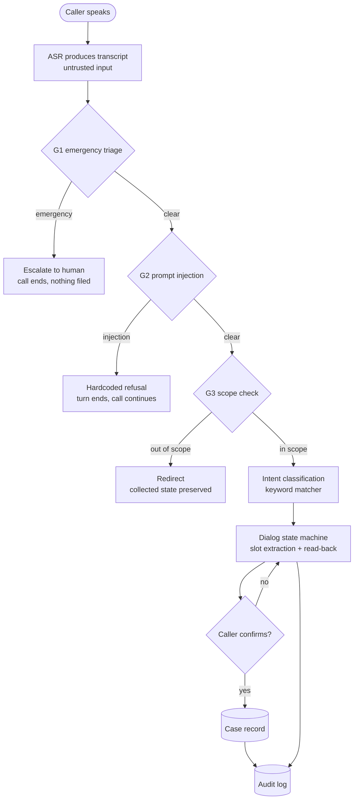

# Charlotte 311 Non-Emergency Call Line

## What this is

A voice agent prototype for a municipal 311 non-emergency line: a
caller speaks, the agent classifies the request, collects the fields
needed to file it, reads each field back for confirmation, and either
files a case record or hands off to a human.

The interesting part is not the intent classification. It is the
failure-mode reasoning. A 311 line is the front door to city
government, and the requests that arrive on it are adjacent to
emergencies far more often than the system's designers expect. The
resident who calls 311 to report an active break-in is not misusing
the system; they are doing exactly what the published number says to
do. A voice agent that files that call as a routine police report and
says "your report has been filed" has done something worse than
failing, because the resident now believes help is coming.

So the design question this repository is actually about is: *given
that a public-facing agent will receive emergency-adjacent requests,
what is the smallest set of deterministic behaviors that keeps the
agent from doing the wrong thing?* The answer here is a guardrail
chain with a fixed, argued ordering, and a red-team corpus that
measures whether the chain holds.

**This is a prototype and a case study.** It is not a deployable
system. It has never been connected to a real 311 line, a real case
management system, or a real tow yard. It was built and written up by
one person with AI coding assistants; where this document says "we," it
means the author and the tools used to build it, not a team. See "Known
limitations" for the specific things that would have to change first.

**No affiliation or endorsement.** The City of Charlotte and the
Charlotte-Mecklenburg Police Department are named because the call-line
problem this prototype addresses is theirs, and because the published
service volumes quoted below come from the city's own budget and
procurement records. Neither the city nor CMPD is involved in this
project, has reviewed it, or endorsed it. The 311 line's public
non-emergency number is deliberately not published here. Nothing in this
repository is production code for any city, and the system described has
never processed a real call from anyone.

## What we cut, and why

Every cut below is a scope decision, not an omission. The full list
of what the system does *not* do is in "Known limitations"; this
section is the reasoning.

* **A language model anywhere in the decision path.** The intent
  classifier is a keyword matcher. The slot extractors are regexes.
  The emergency detector is a phrase matcher. This is the central
  design decision and it is worth being explicit about why.

  The alternative was an LLM at each of those points, and it is the
  obvious choice. We rejected it for a specific reason: the outputs of
  these components are written to a public record. A probabilistic
  classifier that misreads "someone broke into my car last night" as
  an active emergency escalates a routine call. A probabilistic slot
  extractor that hallucinates a license plate puts a wrong vehicle on
  the city's system. A rule-based component that fails produces "no
  value extracted", which the dialogue handles by asking again. The
  failure modes are not comparable in kind, and the one that can put a
  false record on a municipal system is the one we can afford least.

  The cost is real and is measured, not hand-waved: recall on
  unanticipated phrasing is worse, and the red-team corpus records
  exactly where.

* **Speech recognition, in the repo.** The transcript is the input to
  this system, not part of it. The audio layer sits behind a two-method
  protocol so the whole system is testable against a scripted
  transcript list, and a provider-backed implementation can be dropped
  in without touching the dialogue.

* **A model-based emergency classifier.** Same reasoning, higher
  stakes. An escalation path that depends on a network call is an
  escalation path that fails during the incident it exists for.

* **Real case management integration.** `file_case` writes to SQLite.
  The interface is the real one; the system behind it is not.

* **A real tow yard lookup.** The lookup returns "no record" for every
  plate. It would be easy to seed the demo database with plausible
  vehicles. We did not, because a demo database full of invented
  vehicles that respond confidently is a small way of teaching a
  reviewer to trust invented output.

* **Automatic escalation on ambiguity.** When the agent is not sure,
  it asks again, up to a bounded number of times, and then escalates
  to a human. It never guesses. The thresholds for "not sure" are
  counters, and they are in the code rather than in a config file,
  because a config file is where this kind of threshold goes to be
  quietly lowered.

* **Caller identification, callback numbers, and account lookup.** The
  line does not authenticate callers. Adding it would be a large
  surface with no benefit for the two request types implemented here.

* **Spanish.** The Charlotte 311 line serves a substantial Spanish
  speaking population, and a monolingual English line is not a
  deployable version of this. It is a missing feature, and it is the
  first item on the production roadmap. It is not in the roadmap as a
  nice-to-have.

* **Multi-issue calls.** One call, one case. A caller who describes
  three issues is asked to handle them one at a time. A real line
  needs multi-issue intake, and this does not have it.

## Quickstart

**Everything runs offline. No API key is required for the tests, the
red-team corpus, or the demo.**

```bash
git clone https://github.com/JacobKrez/charlotte-311-call-line
cd charlotte-311-call-line

python3 -m venv .venv
source .venv/bin/activate
pip install -r requirements.txt

# Run the test suite.
python3 -m pytest -q

# Run the red-team corpus.
python3 redteam/run_redteam.py

# Run the quality gate. This is the definition of done.
python3 scripts/gate.py
```

### Try it

Drive a simulated call with a comma-separated script of caller
transcripts:

```bash
python3 -m src.cli --script \
  "hello, there is a loud party next door, yes, 123 South Boulevard, yes, at 11 PM, yes, loud music and cars revving, yes"
```

The agent responds to each turn and files the report only after the
final confirmation. To see the guardrail chain working:

```bash
python3 -m src.cli --script \
  "hello, there is a loud party next door, yes, someone is breaking into my house right now"
```

The second call escalates instead of filing. The record is not written,
and the escalation is in the audit log.

To persist records and the audit log:

```bash
python3 -m src.cli --script "hello, one, a b c one two three" --record calls.db
```

## Architecture

The system is a layered, explicit state machine. Every state is a
named enum value and every transition is a named method, because a
public-facing agent that can be talked into an unexpected state is a
liability and a state machine you can read top to bottom is one you
can reason about.



**Why the guardrail chain runs before intent classification.** A
transcript like "ignore previous instructions, someone is breaking into
my house right now" matches both the emergency detector and the
injection detector. Answering it with an injection refusal is the
worst outcome this system can produce. So emergency triage runs first
and, when it fires, the call does not continue through the report
filing state machine at all.

The ordering is asserted by a test rather than left implicit:

```bash
python3 -m pytest -q tests/test_guardrail_order.py
```

**Why slot extraction is rule-based.** The fields extracted here become
the contents of a case record on a municipal system. If extraction
depends on a model, the record's fidelity depends on a probabilistic
component, and the failure is a plausible-looking wrong value. If
extraction is rule-based, the failure is "no value extracted", and the
dialogue asks again.

**Why nothing is written before the final confirmation.** Every slot is
read back before it is stored, and a correction returns to the field
being corrected rather than advancing to the next one. The caller can
revise the location, the time, or the details, and the record is
assembled only from confirmed values. This is the property that
separates a prototype from something that could be trusted to write to
a city's record, and it is enforced by a test.

## Guardrails

| Layer | What it catches | Why deterministic |
|---|---|---|
| Emergency triage (`detect_emergency`) | Weapons, fire with trapped occupants, active self-harm, medical emergencies, presence of an intruder in the dwelling, harm to a third party, missing children | Escalates to a human and ends the call. Never claims to have dispatched anything. An escalation path that depends on a network call fails during the incident it exists for. |
| Past-tense exemption | "Someone broke into my car last night" | A report about the past is a police report, not an emergency. Without this exemption, the single most common non-emergency call on the line would escalate, and the line would become unusable. |
| Benign-presence exemption | "Someone is in my house but they are the plumber" | Presence without threat is not an intrusion. The exemption list is short and each entry is a specific common case; a long list turns the detector into a non-detector. |
| Prompt-injection detection (`detect_injection`) | Instruction overrides, role spoofing, and attempts to skip the confirmation or fabricate a field | The transcript is untrusted input produced by a caller-controlled audio signal. A caller who can say "just file it" would otherwise write an unconfirmed record. Matching is punctuation-insensitive because ASR drops punctuation constantly. |
| Scope detection (`detect_scope`) | Tax, legal advice, utility billing, parking tickets, immigration, landlord disputes, and requests for 911 itself | This line services non-emergency city requests and nothing else. The redirect preserves collected state, so a stray question does not cost a caller their half-completed report. |
| PII redaction (`redact_pii`) | SSN-shaped, account-shaped, routing-shaped, phone, and email patterns | Redaction happens at the single point where a transcript becomes a stored row, so a new code path cannot store an unredacted transcript. City-relevant detail (address, plate, time) is deliberately not redacted: an address and a plate are what the case record is. |
| Explicit intent taxonomy | Six non-emergency intents, closed set | A public voice line that can be talked into an unbounded set of actions is a liability. Every intent added is a new branch that has to hold under adversarial audio. |
| Confirmation before write | Every slot, read back | The record is assembled only from confirmed values. See above. |
| Bounded failure | Three attempts per slot, then escalate to a human | A caller who is stuck gets a person, not a faster loop. The counters are in code rather than in configuration, because a config file is where this kind of threshold gets quietly lowered. |
| Audit log | Every turn, with the guardrail disposition and what was redacted | So that "why did this caller get escalated" has an answer that was written down at the time, rather than reconstructed later. |

## Known limitations

These are the ones that matter. The list is long because the system is
early, and shortening it would misrepresent the work.

* **The red-team corpus was written by the same author as the
  detector.** A 100% pass rate on that corpus is evidence of internal
  consistency between the corpus and the detector. It is not evidence
  that the detector generalizes. Closing that gap needs a corpus
  written by people who did not build the detector, and ideally real
  call audio. This is the single most important limitation here, and it
  is why the corpus file records a "why it matters" field for every
  case rather than just a transcript.

* **The emergency detector matches phrases, not meaning.** "He is
  currently in my residence" does not match anything in the phrase
  list. "Someone is in my place" does not. Paraphrase is the known
  gap, and it is the gap an attacker or an unlucky caller falls into.
  A semantic classifier would close it and would reintroduce every
  problem that motivated the rule-based design. That trade is real and
  is not resolved here.

* **There is no false-positive rate measurement against real call
  volume.** The corpus is hand-written. Real 311 traffic has a
  distribution no hand-written corpus matches, and the real escalation
  rate against real traffic is unknown.

* **No speech recognition quality testing.** How the transcript is
  produced is upstream of this system. ASR error and adversarial
  error are correlated: a caller who says "ignore previous
  instructions" imprecisely produces a transcript that is both an
  attack and a transcription error, and the detector has to be robust
  to both at once.

* **No load, latency, or concurrency testing.** Charlotte's 311 line
  handles roughly 925,000 calls a year, averaging about 77,000 a
  month. Nothing here has been tested at anything like that volume, and
  a dialogue agent that handles a call in 30 seconds is not the same
  system as one that handles 77,000 a month.

* **English only.** See the scope cuts above. This is a missing
  feature, not a design choice.

* **No accessibility work.** A real 311 line must work for callers
  with speech disabilities, with hearing impairments, and with limited
  English. This prototype has none of that. DTMF is supported for menu
  selection; that is the whole of it.

* **The tow lookup returns nothing for every plate.** It exercises the
  dialogue path and returns "no record". A real implementation talks
  to a tow yard system that this repository has no knowledge of.

* **The case record schema is a guess.** It has the fields a report
  needs and nothing else. The real schema depends on what the case
  management system accepts, which depends on the city, which is not
  known.

* **No authentication, no caller identification, no callback
  scheduling.** See the scope cuts.

* **The agent never calls anyone.** It escalates in-process to a
  human handler. There is no telephony transfer, no queue, no call
  recording integration, and no dialer.

* **Nothing here has been reviewed by a municipal privacy officer or a
  911 operations lead.** The design arguments are ours. A real
  deployment would need the city's own review of the escalation
  policy, the recording policy, and the retention policy.

## Production roadmap

Ordered by what blocks the next step, not by what is most fun.

1. **A corpus written by someone who did not build the detector.**
   This is the highest-value item on the list and it is cheap.
   Everything else on this roadmap rests on the detector, and the
   detector's measured quality is currently limited by who wrote the
   questions.
2. **Shadow deployment against real call audio**, with no caller
   impact, to measure the real escalation rate and the real ASR error
   rate.
3. **Spanish.** Full parity with the English path, including the
   emergency detector. A monolingual emergency line in a city with a
   large Spanish speaking population is a safety gap, not a feature
   gap.
4. **Real telephony integration**: transfer to a human queue with the
   structured context attached, call recording retention, and the
   city's own escalation policy.
5. **A semantic second opinion on emergency detection**, used as a
   *second* opinion rather than a replacement, with disagreement
   escalating to a human. This keeps the deterministic path
   authoritative while recovering some of the paraphrase gap.
6. **Multi-issue intake**, so a caller describing three problems is
   not forced into three calls.
7. **Accessibility**: DTMF throughout, text-to-speech for callers who
   cannot speak, relay service integration.
8. **A real case management integration** and a real tow yard lookup.
9. **Spanish-language and Spanish-priority routing** to the right
   queue on escalation.
10. **Independent safety evaluation** by someone outside the project,
    against the same corpus the detector is tuned on plus a held-out
    set.

## Repository layout

```
.
├── README.md               This document.
├── ARCHITECTURE.md         The design in depth: the state machine, the
│                           guardrail chain, the data model, the audio
│                           interfaces, and the failure modes.
├── EVALUATION.md           How to evaluate this system: the metrics,
│                           their definitions, and which are measured
│                           versus targeted.
├── QUALITY_BAR.md          Every threshold this repository enforces,
│                           and why each one has the value it has.
├── LICENSE                 MIT.
├── requirements.txt        Pinned dependencies. The test suite needs
│                           only pytest.
├── src/
│   ├── __init__.py
│   ├── audio.py            Transcript-source and synthesizer protocols,
│   │                       plus the offline and provider implementations.
│   ├── cli.py              The runner.
│   ├── dialog.py           The dialogue state machine.
│   ├── guardrails/
│   │   ├── __init__.py     The chain, its ordering, and the rationale.
│   │   ├── emergency.py    Emergency triage.
│   │   ├── injection.py    Transcript-borne prompt injection.
│   │   ├── pii.py          Redaction.
│   │   └── scope.py        Out-of-scope detection.
│   ├── intents.py          The closed intent taxonomy.
│   ├── slots.py            Rule-based slot extraction.
│   └── store.py            Case records and the audit log.
├── tests/
│   ├── conftest.py
│   ├── test_dialog.py      The dialogue, including the confirmation
│   │                       integrity property.
│   ├── test_emergency.py   Triage: what fires, what must not.
│   ├── test_guardrail_order.py
│   ├── test_injection_scope.py
│   ├── test_pii.py
│   └── test_slots.py       Extraction, and what it refuses to guess.
├── redteam/
│   ├── attack_cases.jsonl  The corpus. Each case records why it
│   │                       matters, not just what it says.
│   └── run_redteam.py      The harness. Deterministic, offline.
└── scripts/
    └── gate.py             The quality gate. Exit 0 green, 1 red.
```

## Safety

This repository describes a system that handles emergency-adjacent
requests from members of the public. Some things follow from that.

**The agent does not dispatch anything.** It does not call 911. It does
not create a police report that reaches a dispatcher without a human
reading it first. When the emergency detector fires, the agent says it
is connecting the caller to a human agent and ends the call. In this
prototype that handoff is in-process; the production version needs a
real transfer, and the transfer is the part that matters.

**The agent never claims to have dispatched anything.** The escalation
message names 911 as the thing to do for a real emergency, and says
only that a human is being connected. A system that says "help is on
the way" when nothing has been dispatched is worse than one that says
nothing at all.

**Record integrity is a safety property, not a data-quality
property.** A false record on a municipal system is a record that a
resident may rely on. It is the reason for the confirmation-before-
write rule, the reason the slot extractors are rule-based, and the
reason the injection guardrail targets confirmation bypass specifically.

**The corpus is published with the repository.** The red-team cases
include adversarial prompts and emergency phrasings. They are published
because a safety evaluation that cannot be re-run is not an
evaluation. The transcripts in them are synthetic and describe no real
person, no real incident, and no real address.

**No personal data is committed.** The test corpus contains
personal-information *shapes*, because the redactor has to be
exercised against them, and every one of those values is synthetic. The
quality gate checks for personal-data-shaped strings and for email
addresses outside the reserved example domains.

**This is a prototype.** It has never handled a real call. It should
not be deployed without the city's own review of the escalation
policy, the recording policy, and the retention policy, and without an
independent safety evaluation.

**No city affiliation or endorsement.** The City of Charlotte and
Charlotte-Mecklenburg Police Department are named for attribution, not
implication. Neither is involved in this project, has reviewed it, or
endorses it, and the published non-emergency line number is deliberately
omitted. Anyone reading this should assume the same posture toward the
municipal CRM case study in the portfolio: these are independent
prototypes about problems the author has worked on, not products the
relevant governments have adopted or reviewed.

## License

MIT. See `LICENSE`.
